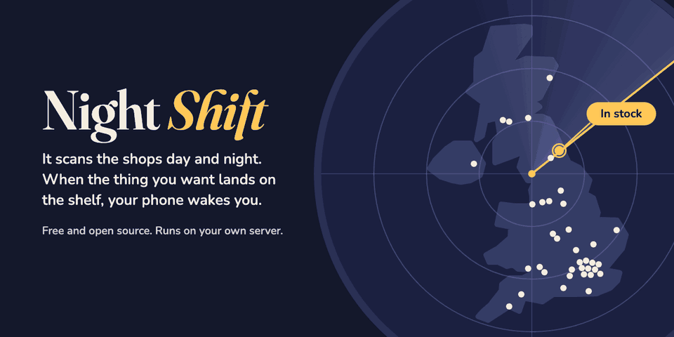

# Night Shift

Telegram alerts when an iPhone Duo appears for pickup at UK Apple Stores. Self-hosted, one Python file, notify only.



It checks pickup stock and sends a Telegram message when a model appears. It only notifies and never buys. The method is unofficial and rests on an undocumented Apple endpoint that can change or stop working without notice. It is for people comfortable with a VPS and SSH; paid hosted tools exist for everyone else.

The iPhone Duo went on sale in the UK on 23 October 2026. I could not buy one for nearly three weeks. Store staff told me small unannounced deliveries get listed for pickup. I built this with Claude on 10 November 2026; within 12 hours it alerted me and I bought the model I wanted.

## Quick start

Needs systemd, Python 3.9 or newer and a Telegram bot token from @BotFather.

```
git clone https://github.com/nfroze/night-shift.git
cd night-shift
cp config.example.json config.json
nano config.json
python3 stock_alert.py --once
sudo bash install.sh
```

Set your stores and models in `config.json` first; the tables below list their numbers. `--once` makes one strict check against Apple from your host and exits non-zero if any search fails. `install.sh` then asks for the bot token (hidden prompt), reads your chat ID from a message you send the bot (one sent in the last day, or it waits 90 seconds), sends a test alert to confirm, and installs the service.

## Configuration

`config.json` beside `install.sh` is the source of truth. Edit it there and run `sudo bash install.sh` again; edits under `/opt/stock-alert` are overwritten. A re-run repeats every step, token prompt included, and restarts the service.

```json
{
  "poll_seconds": 30,
  "stores": ["R341", "R423"],
  "models": ["MK2E4QN/A", "MK2G4QN/A"]
}
```

| Key | Default | Limits |
|---|---|---|
| `stores` | required | store numbers, or `{number, name, postcode}`; at least 1, no duplicates |
| `models` | required | part numbers, or `{part, name, ask_about, buy_url}`; at least 1, no duplicates |
| `poll_seconds` | 30 | floor 5, ceiling 300 |
| `remind_seconds` | 180 | floor 60, ceiling 86400 |
| `warn_after_seconds` | 900 | floor is the larger of 120 and 2 x interval + searches x 15.25; ceiling 86400 |
| `messages_per_alert` | 1 | 1 to 5 |
| `country_path` | `"/uk"` | must look like `/xx` or `/xx-yyyy` |

Values below a floor are raised and logged, except `warn_after_seconds`, which is refused. Values above a ceiling are refused. Unknown keys are refused, except those starting with an underscore. At most 12 searches in all (see How it works).

Keep the default of 30 seconds. The interval is the largest of `poll_seconds`, 5 seconds and 1.25 seconds per search, which holds the average to 48 requests a minute or fewer: the rate I ran for 12 hours without throttling or blocking. If Apple answers 429 or 403, or 503 with a Retry-After, every search pauses for about the Retry-After (taken as at most an hour), or backs off as for failed checks if there is none.

The 39 UK stores and 8 part numbers below were checked against Apple's public UK pages on 11 November 2026.

| Model | Part number |
|---|---|
| iPhone Duo 256GB Star White | `MK2D4QN/A` |
| iPhone Duo 256GB Night Sky | `MK2E4QN/A` |
| iPhone Duo 512GB Star White | `MK2F4QN/A` |
| iPhone Duo 512GB Night Sky | `MK2G4QN/A` |
| iPhone Duo 1TB Star White | `MK2H4QN/A` |
| iPhone Duo 1TB Night Sky | `MK2J4QN/A` |
| iPhone Duo 2TB Star White | `MK2K4QN/A` |
| iPhone Duo 2TB Night Sky | `MK2L4QN/A` |

<details>
<summary>All UK Apple Stores and their numbers</summary>

| Town or city | Store | Number |
|---|---|---|
| Aberdeen | Apple Union Square | `R363` |
| Basingstoke | Apple Festival Place | `R482` |
| Bath | Apple SouthGate | `R335` |
| Belfast | Apple Belfast | `R313` |
| Birmingham | Apple Birmingham | `R118` |
| Brighton | Apple Churchill Square | `R244` |
| Bristol | Apple Cribbs Causeway | `R393` |
| Bromley | Apple Bromley | `R496` |
| Cambridge | Apple Grand Arcade | `R270` |
| Cardiff | Apple Cardiff | `R334` |
| Edinburgh | Apple Edinburgh | `R328` |
| Exeter | Apple Princesshay | `R279` |
| Gateshead | Apple Metrocentre | `R423` |
| Glasgow | Apple Braehead | `R340` |
| Glasgow | Apple Glasgow | `R135` |
| Grays | Apple Lakeside | `R242` |
| Greenhithe | Apple Bluewater | `R113` |
| Kingston upon Thames | Apple Bentall Centre | `R227` |
| Leeds | Apple Trinity Leeds | `R372` |
| Leicester | Apple Highcross | `R308` |
| Liverpool | Apple Liverpool | `R239` |
| London | Apple Battersea | `R762` |
| London | Apple Brent Cross | `R163` |
| London | Apple Brompton Road | `R329` |
| London | Apple Covent Garden | `R245` |
| London | Apple Regent Street | `R092` |
| London | Apple Stratford City | `R410` |
| London | Apple White City | `R226` |
| Manchester | Apple Manchester Arndale | `R215` |
| Manchester | Apple Trafford Centre | `R136` |
| Milton Keynes | Apple Milton Keynes | `R269` |
| Newcastle upon Tyne | Apple Eldon Square | `R341` |
| Norwich | Apple Norwich | `R391` |
| Plymouth | Apple Plymouth | `R545` |
| Reading | Apple The Oracle | `R176` |
| Sheffield | Apple Meadowhall | `R153` |
| Solihull | Apple Touchwood Centre | `R255` |
| Southampton | Apple Southampton | `R174` |
| Watford | Apple Watford | `R527` |

</details>

## What you get

Each time a watched model shows in stock at a watched store, you get this message, repeated every `remind_seconds` while it stays in stock:

```
IN STOCK: {model}
{store} - {quote}
Reserve for pickup now: {buy_url}
```

If a search has no good answer for `warn_after_seconds`, one message lists everything not being watched and the last error. Another arrives when all reads work again. Silence means the reads that worked showed no stock.

## Top tip

Optional: Telegram lets you give one chat its own notification sound (Settings, Notifications and Sounds; announced in April 2022). For an alarm that keeps sounding until acknowledged, I wired my own copy into Pushover at its highest priority. That is not included; to add a second channel, use `send()` in `stock_alert.py`, the only place a message leaves the watcher.

## Running it

| Task | Command |
|---|---|
| Follow the log | `journalctl -u stock-alert -f` |
| Stop and disable | `sudo systemctl disable --now stock-alert` |
| Uninstall | `sudo bash install.sh --uninstall` |

`--uninstall` disables the service and removes the unit, its drop-in directory, `/opt/stock-alert` and `/etc/stock-alert.env`. Revoke the bot token with @BotFather afterwards. Running it twice is safe.

By hand:

```
export TELEGRAM_BOT_TOKEN='YOUR-BOT-TOKEN'
export TELEGRAM_CHAT_ID="$(python3 stock_alert.py --chat-id)"   # message your bot first
python3 stock_alert.py --test
python3 stock_alert.py
```

Docker is tested: the image builds and runs as a non-root user, without `install.sh`.

```
docker build -t night-shift .
docker run -d --restart unless-stopped \
  -e TELEGRAM_BOT_TOKEN='YOUR-BOT-TOKEN' \
  -e TELEGRAM_CHAT_ID='YOUR-CHAT-ID' \
  -v "$(pwd)/config.json:/config/config.json:ro" \
  night-shift
```

## How it works

Apple has no official pickup stock API, so Night Shift sends the request Apple's own store page makes to check availability. The answer does not list the model you ask about, so the watcher asks about the same phone in the other colour, its twin, and reads the answer for the one you want.

A search is one store asked about one twin, from that store's postcode. Each check runs one search per store and twin (stores that share a postcode share a search), 0.25 seconds apart, and each answer is acted on as it arrives.

A search fails on no complete answer within 15 seconds, an answer over 2 MB, a non-200 status, a body that is not JSON, a missing store list or searched store, a missing availability list, or an unknown pickup status. A failed search is never read as no stock and never clears an earlier alert. If every search in a check fails, the next check waits longer, up to 10 minutes.

## CLI

| Command | Does |
|---|---|
| `stock_alert.py` | Run the watcher |
| `--once` | One strict pass; prints hits and the other models Apple listed at your stores |
| `--stores POSTCODE` | List the nearest stores with their numbers |
| `--models` | List the bundled part numbers |
| `--chat-id` | Print the chat ID of the chat that most recently messaged the bot |
| `--test` | Send a test alert |
| `--verify-stores` | Check every bundled store number against Apple |
| `--config PATH` | Use a config file other than `config.json` beside the script (or the path in `STOCK_ALERT_CONFIG`) |

## Limits

- Undocumented endpoint: it can change or stop working without notice. A new Apple pickup status fails searches, and warns you, until it is added.
- State is in memory. A restart forgets what has been alerted, so an alert may repeat and the startup message is sent again.
- Telegram's `retry_after` is not handled, and a lost answer can cost one duplicate alert per reminder interval.
- No HTTPS proxies and no redirects; a 301 is a failed search.
- The installer's test alert confirmation is how you check `--chat-id` found your chat.
- UK data only; the store and model lists go stale.

## Development

```
python3 -B -m unittest
```

The tests run in the repo folder against a fake Apple and Telegram server on 127.0.0.1 with a fake clock. Python 3.9 is the minimum, and CI runs the suite on 3.9, 3.12, 3.13 and 3.14.

## Licence

MIT. See [LICENSE](LICENSE). Night Shift is not affiliated with or approved by Apple.
